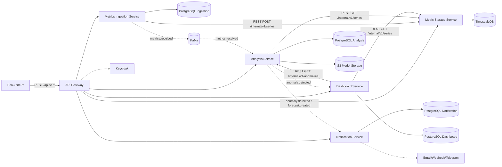
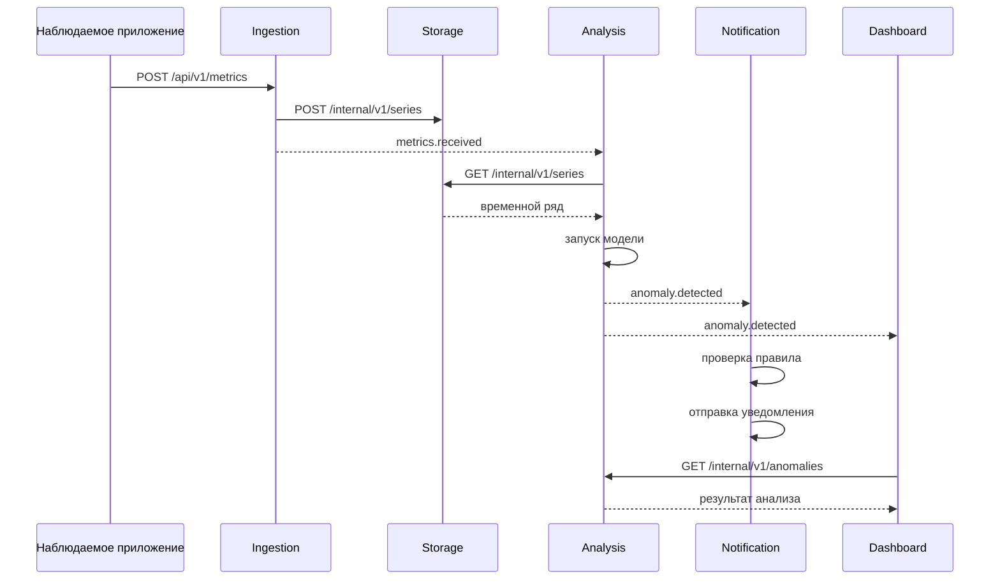
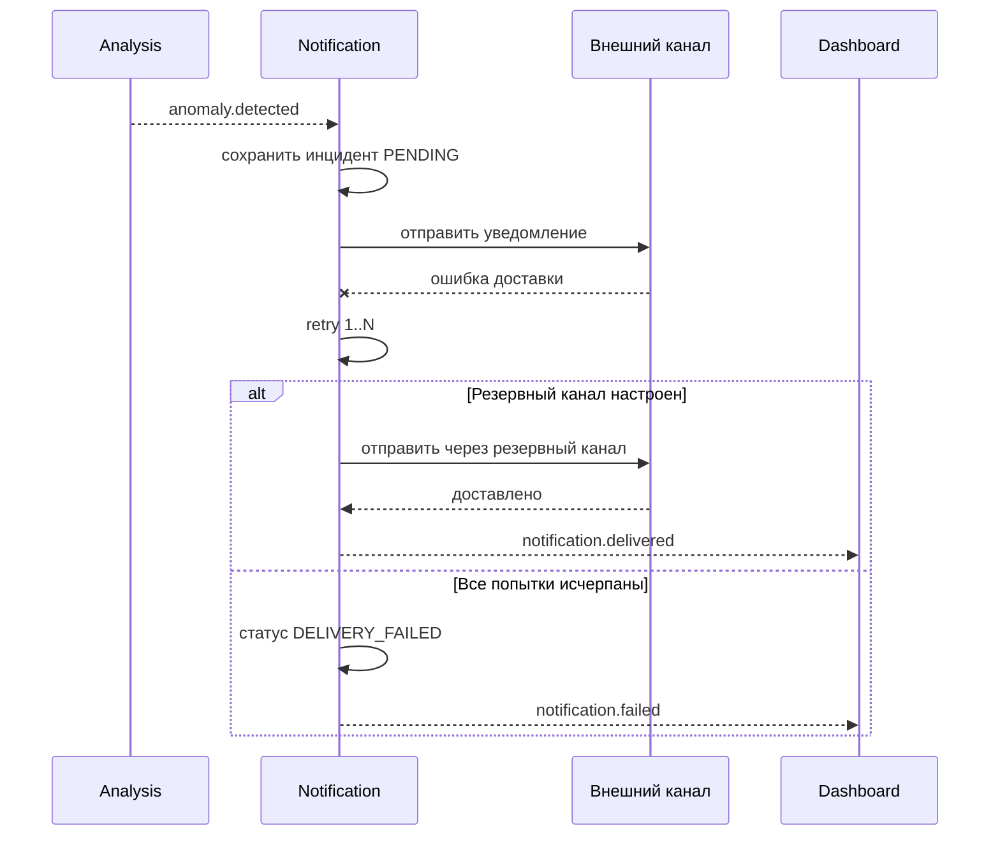

# Лабораторная работа №3
## Декомпозиция и проектирование микросервисной системы

**Тема:** микросервисная система интеллектуального мониторинга приложений.

## 1. Анализ предметной области

Система получает эксплуатационные метрики приложений и инфраструктуры, сохраняет их и предоставляет пользователю графики и результаты анализа. Она обнаруживает аномалии во временных рядах с использованием правил и алгоритмов машинного обучения. Для выбранных метрик система строит прогнозы и формирует уведомления при обнаружении аномального поведения или ожидаемом достижении критического значения. Система предназначена для разработчиков, DevOps-инженеров и администраторов небольших и средних проектов.

### Акторы

- **Пользователь** — просматривает метрики, настраивает правила и получает уведомления.
- **Администратор** — управляет источниками метрик, пользователями и настройками системы.
- **Наблюдаемое приложение** — передаёт метрики в систему.
- **Система доставки уведомлений** — внешний провайдер электронной почты, Webhook или Telegram.

### Пользовательские сценарии

1. Как пользователь, я хочу подключить источник метрик, чтобы система получала данные приложения.
2. Как пользователь, я хочу просматривать графики метрик за выбранный период, чтобы оценивать состояние приложения.
3. Как пользователь, я хочу запустить анализ метрики, чтобы обнаружить аномальные значения.
4. Как пользователь, я хочу получить прогноз развития метрики, чтобы заранее выявить возможную проблему.
5. Как пользователь, я хочу настроить порог и канал уведомлений, чтобы узнавать о важных событиях.
6. Как администратор, я хочу отключить источник метрик, чтобы прекратить обработку его данных.
7. Как пользователь, я хочу просмотреть историю обнаруженных аномалий, чтобы анализировать причины инцидентов.

### Доменные события

- ИсточникМетрикПодключён.
- МетрикаПолучена.
- ПакетМетрикСохранён.
- АнализМетрикиЗапущен.
- АномалияОбнаружена.
- ПрогнозПостроен.
- ПравилоУведомленияСоздано.
- УведомлениеСформировано.
- УведомлениеДоставлено.
- УведомлениеНеДоставлено.
- ИсточникМетрикОтключён.

## 2. Ограниченные контексты

| Контекст | Назначение | Термины контекста |
|---|---|---|
| Сбор метрик | Подключение источников и приём временных рядов | **Источник** — зарегистрированный отправитель метрик; **Метрика** — измеряемый показатель; **Образец** — значение метрики с временной меткой; **Пакет** — набор образцов за один приём |
| Хранение и запрос метрик | Сохранение истории и выдача значений для анализа и графиков | **Временной ряд** — значения одной метрики во времени; **Диапазон** — интервал времени запроса; **Агрегация** — преобразование ряда в интервалы; **Точка** — агрегированное значение |
| Анализ метрик | Обнаружение аномалий и построение прогнозов | **Задача анализа** — запуск обработки ряда; **Аномалия** — отклонение от нормального поведения; **Оценка аномальности** — числовая степень отклонения; **Прогноз** — ожидаемые будущие значения |
| Уведомления | Настройка правил и доставка сообщений | **Правило** — условие формирования уведомления; **Инцидент** — зафиксированное нарушение; **Канал** — способ доставки; **Попытка доставки** — отдельная отправка сообщения |
| Представление мониторинга | Формирование сводок, виджетов и пользовательских представлений | **Дашборд** — набор виджетов; **Виджет** — элемент отображения метрики; **Запрос** — параметры получения данных; **Сводка** — агрегированное состояние системы |

### Обоснование границ

Контексты разделены по бизнес-возможностям и владению данными. Сбор метрик отвечает за приём, хранение и запрос — за исторические данные, анализ — за модели и результаты обработки, уведомления — за правила и доставку, представление — за пользовательские дашборды. Общая база данных между контекстами не используется: обмен выполняется через API и события.

## 3. Сервисы

### 3.1. Metrics Ingestion Service

- **Назначение:** регистрация источников и приём метрик.
- **Данные:** источники, настройки приёма, статус подключения.
- **Хранилище:** PostgreSQL.
- **Взаимодействия:** передаёт принятые пакеты в Metric Storage Service; публикует `metrics.received`.
- **Почему отдельный сервис:** приём данных имеет собственные требования к пропускной способности и может масштабироваться независимо.

### 3.2. Metric Storage Service

- **Назначение:** хранение временных рядов и выдача данных за период.
- **Данные:** временные ряды и агрегаты.
- **Хранилище:** TimescaleDB.
- **Взаимодействия:** получает данные от Metrics Ingestion Service; предоставляет данные Analysis Service и Dashboard Service по REST.
- **Почему отдельный сервис:** хранение временных рядов имеет другую модель и нагрузку, чем приём и анализ.

### 3.3. Analysis Service

- **Назначение:** обнаружение аномалий и прогнозирование метрик.
- **Данные:** задачи анализа, версии моделей, результаты анализа.
- **Хранилище:** PostgreSQL и объектное хранилище для моделей.
- **Взаимодействия:** запрашивает ряд у Metric Storage Service; публикует `anomaly.detected` и `forecast.created`.
- **Почему отдельный сервис:** модели машинного обучения требуют отдельного масштабирования и жизненного цикла.

### 3.4. Notification Service

- **Назначение:** правила, инциденты и доставка уведомлений.
- **Данные:** правила, каналы, инциденты, попытки доставки.
- **Хранилище:** PostgreSQL.
- **Взаимодействия:** получает `anomaly.detected` и `forecast.created`; вызывает внешние каналы доставки.
- **Почему отдельный сервис:** логика уведомлений и повторные попытки не должны зависеть от анализа и хранения метрик.

### 3.5. Dashboard Service

- **Назначение:** пользовательские дашборды, виджеты и сводки.
- **Данные:** дашборды, виджеты, пользовательские настройки.
- **Хранилище:** PostgreSQL.
- **Взаимодействия:** запрашивает метрики у Metric Storage Service и результаты у Analysis Service; получает уведомления о новых аномалиях.
- **Почему отдельный сервис:** представление и пользовательские настройки могут изменяться независимо от алгоритмов анализа.


### Отвергнутый вариант разбиения

Рассматривалось объединение Metrics Ingestion Service и Metric Storage Service. От варианта отказались, поскольку приём метрик и аналитические запросы имеют разные профили нагрузки: приём выполняется непрерывно, а запросы истории и агрегаций требуют отдельного масштабирования. Также рассматривалось объединение Analysis Service и Notification Service, но эти сервисы имеют разные зоны ответственности: анализ вычисляет результат, а уведомления управляют правилами, каналами и повторными доставками.

## 4. Выбор готового ПО

| Компонент | Какие сервисы используют | Обоснование |
|---|---|---|
| API Gateway (Kong) | Все внешние запросы | Единая точка входа, маршрутизация, ограничение частоты и проверка JWT; клиент не обращается к сервисам напрямую. |
| Keycloak | API Gateway и все сервисы через JWT | Централизованная аутентификация и роли администратора/пользователя без отдельного бизнес-сервиса пользователей. |
| PostgreSQL | Metrics Ingestion, Analysis, Notification, Dashboard | Транзакционные настройки, правила, результаты и пользовательские данные требуют надёжных связей и транзакций; базы развёртываются отдельно для каждого сервиса. |
| TimescaleDB | Metric Storage | Расширение PostgreSQL для временных рядов, позволяющее эффективно хранить метрики, выполнять агрегации и запросы по времени. |
| Apache Kafka | Metrics Ingestion, Analysis, Notification, Dashboard | Буферизация потока метрик и доставка доменных событий с повторным чтением и независимыми подписчиками. |
| Redis | Metrics Ingestion, Analysis, Notification | Кэширование короткоживущих данных, блокировки заданий и дедупликация сообщений; не является общей бизнес-базой. |
| S3-совместимое объектное хранилище | Analysis Service | Хранение версий ML-моделей и артефактов независимо от транзакционной базы. |

## 5. Схема взаимодействий

### 5.1. Архитектурная схема



Сплошные стрелки обозначают синхронные REST-вызовы, пунктирные — асинхронные события Kafka. Каждый сервис владеет только своим хранилищем.

### 5.2. Основной сценарий: обнаружение аномалии



### 5.3. Сценарий сбоя и компенсирующее действие

Сбой происходит при доставке уведомления. Анализ уже завершён, поэтому результат не откатывается. Notification Service сохраняет инцидент со статусом `PENDING`, выполняет повторные попытки с увеличением интервала. После исчерпания попыток он помечает инцидент как `DELIVERY_FAILED` и публикует событие `notification.failed`. Компенсирующее действие — создание задачи повторной доставки и переключение на резервный канал, если он настроен.



### 5.4. Таблица взаимодействий

| Отправитель | Получатель | Способ | Контракт |
|---|---|---|---|
| Клиент через Gateway | Metrics Ingestion | REST | `POST /api/v1/metrics` |
| Metrics Ingestion | Metric Storage | REST | `POST /internal/v1/series` |
| Analysis | Metric Storage | REST | `GET /internal/v1/series` |
| Dashboard | Metric Storage | REST | `GET /internal/v1/series` |
| Dashboard | Analysis | REST | `GET /internal/v1/anomalies` |
| Metrics Ingestion | Analysis | Kafka | `metrics.received` |
| Analysis | Notification | Kafka | `anomaly.detected` |
| Analysis | Dashboard | Kafka | `anomaly.detected` |
| Notification | Dashboard | Kafka | `notification.failed` / `notification.delivered` |

## 6. События

| Топик | Издатель | Подписчики | Схема |
|---|---|---|---|
| `metrics.received` | Metrics Ingestion | Analysis | `eventId`, `eventType`, `schemaVersion`, `occurredAt`, `payload.sourceId`, `payload.metricName`, `payload.from`, `payload.to` |
| `anomaly.detected` | Analysis | Notification, Dashboard | `eventId`, `eventType`, `schemaVersion`, `occurredAt`, `payload.analysisId`, `payload.sourceId`, `payload.metricName`, `payload.timestamp`, `payload.score`, `payload.reason` |
| `forecast.created` | Analysis | Notification, Dashboard | `eventId`, `eventType`, `schemaVersion`, `occurredAt`, `payload.analysisId`, `payload.metricName`, `payload.points[]` |
| `notification.delivered` | Notification | Dashboard | `eventId`, `eventType`, `schemaVersion`, `occurredAt`, `payload.incidentId`, `payload.channel` |
| `notification.failed` | Notification | Dashboard | `eventId`, `eventType`, `schemaVersion`, `occurredAt`, `payload.incidentId`, `payload.reason` |

Пример события `anomaly.detected`:

```json
{
  "eventId": "0f6e9d7c-5c16-4b34-9f8a-3d1c2e7a6b10",
  "eventType": "anomaly.detected",
  "schemaVersion": 1,
  "occurredAt": "2026-10-30T10:15:00Z",
  "correlationId": "9a4d1e2c-6b7f-4a08-b3c5-0e1f2d3c4b5a",
  "payload": {
    "analysisId": "a2e0c7f4-1a93-4f0d-8c6e-7d25a1e9f310",
    "sourceId": "3f6c2b0e-8d1a-4c57-9e2f-5a1b7c9d0e44",
    "metricName": "http_request_latency_ms",
    "timestamp": "2026-10-30T10:14:55Z",
    "value": 950.0,
    "score": 0.97,
    "reason": "value_deviation"
  }
}
```

## 7. Контракты API

Во всех контрактах используется единая модель ошибки `Problem`. Внешние запросы выполняются через API Gateway. Для повторяемых операций используется `Idempotency-Key`, для сообщений Kafka — `correlationId`. Внутренние методы помечены тегом `internal`.

### 7.1. Общие схемы

```yaml
openapi: 3.1.0
info:
  title: Intelligent Monitoring API
  version: 1.0.0
components:
  schemas:
    Problem:
      type: object
      required: [type, title, status, detail]
      properties:
        type: {type: string, format: uri}
        title: {type: string}
        status: {type: integer}
        detail: {type: string}
        correlationId: {type: string, format: uuid}
    MetricSample:
      type: object
      required: [timestamp, value]
      properties:
        timestamp: {type: string, format: date-time}
        value: {type: number}
```

### 7.2. Metrics Ingestion Service

```yaml
paths:
  /api/v1/sources:
    post:
      tags: [public]
      summary: Подключить источник метрик
      parameters:
        - in: header
          name: Idempotency-Key
          required: true
          schema: {type: string, format: uuid}
      requestBody:
        required: true
        content:
          application/json:
            schema:
              type: object
              required: [name, endpoint]
              properties:
                name: {type: string}
                endpoint: {type: string, format: uri}
            example: {name: demo-app, endpoint: https://demo.example/metrics}
      responses:
        '201': {description: Источник подключён}
        '400': {description: Некорректные данные, content: {application/problem+json: {schema: {$ref: '#/components/schemas/Problem'}}}}
        '409': {description: Источник уже существует}
  /api/v1/metrics:
    post:
      tags: [public]
      summary: Принять пакет метрик
      parameters:
        - in: header
          name: Idempotency-Key
          required: true
          schema: {type: string, format: uuid}
      requestBody:
        required: true
        content:
          application/json:
            schema:
              type: object
              required: [sourceId, metricName, samples]
              properties:
                sourceId: {type: string, format: uuid}
                metricName: {type: string}
                samples: {type: array, items: {$ref: '#/components/schemas/MetricSample'}}
            example: {sourceId: 3f6c2b0e-8d1a-4c57-9e2f-5a1b7c9d0e44, metricName: cpu_usage, samples: [{timestamp: '2026-10-30T10:15:00Z', value: 72.4}]}
      responses:
        '202': {description: Пакет принят}
        '400': {description: Некорректный пакет}
        '404': {description: Источник не найден}
```

### 7.3. Metric Storage Service

```yaml
paths:
  /internal/v1/series:
    post:
      tags: [internal]
      summary: Сохранить временной ряд
      requestBody:
        required: true
        content:
          application/json:
            schema:
              type: object
              required: [sourceId, metricName, samples]
              properties:
                sourceId: {type: string, format: uuid}
                metricName: {type: string}
                samples: {type: array, items: {$ref: '#/components/schemas/MetricSample'}}
      responses:
        '202': {description: Ряд сохранён}
        '400': {description: Ошибка валидации}
  /api/v1/series:
    get:
      tags: [public]
      summary: Получить временной ряд
      parameters:
        - {in: query, name: sourceId, required: true, schema: {type: string, format: uuid}}
        - {in: query, name: metricName, required: true, schema: {type: string}}
        - {in: query, name: from, required: true, schema: {type: string, format: date-time}}
        - {in: query, name: to, required: true, schema: {type: string, format: date-time}}
        - {in: query, name: page, schema: {type: integer, minimum: 1, default: 1}}
        - {in: query, name: size, schema: {type: integer, minimum: 1, maximum: 1000, default: 100}}
      responses:
        '200': {description: Временной ряд получен}
        '400': {description: Некорректный диапазон}
        '404': {description: Ряд не найден}
```

### 7.4. Analysis Service

```yaml
paths:
  /api/v1/analyses:
    post:
      tags: [public]
      summary: Запустить анализ метрики
      parameters:
        - in: header
          name: Idempotency-Key
          required: true
          schema: {type: string, format: uuid}
      requestBody:
        required: true
        content:
          application/json:
            schema:
              type: object
              required: [sourceId, metricName, from, to]
              properties:
                sourceId: {type: string, format: uuid}
                metricName: {type: string}
                from: {type: string, format: date-time}
                to: {type: string, format: date-time}
                forecastHorizon: {type: integer, minimum: 0}
            example: {sourceId: 3f6c2b0e-8d1a-4c57-9e2f-5a1b7c9d0e44, metricName: cpu_usage, from: '2026-10-29T00:00:00Z', to: '2026-10-30T00:00:00Z', forecastHorizon: 12}
      responses:
        '202': {description: Анализ поставлен в очередь}
        '400': {description: Некорректные параметры}
        '409': {description: Аналогичный анализ уже выполняется}
  /internal/v1/anomalies:
    get:
      tags: [internal]
      summary: Получить результаты анализа
      parameters:
        - {in: query, name: sourceId, required: true, schema: {type: string, format: uuid}}
        - {in: query, name: metricName, required: true, schema: {type: string}}
        - {in: query, name: page, schema: {type: integer, minimum: 1, default: 1}}
        - {in: query, name: size, schema: {type: integer, minimum: 1, maximum: 100, default: 20}}
      responses:
        '200': {description: Результаты получены}
        '400': {description: Некорректные параметры}
```

### 7.5. Notification Service

```yaml
paths:
  /api/v1/notification-rules:
    post:
      tags: [public]
      summary: Создать правило уведомления
      parameters:
        - in: header
          name: Idempotency-Key
          required: true
          schema: {type: string, format: uuid}
      requestBody:
        required: true
        content:
          application/json:
            schema:
              type: object
              required: [metricName, condition, channel]
              properties:
                metricName: {type: string}
                condition: {type: string, enum: [ANOMALY, FORECAST_THRESHOLD]}
                channel: {type: string, enum: [EMAIL, WEBHOOK, TELEGRAM]}
                threshold: {type: number}
            example: {metricName: cpu_usage, condition: ANOMALY, channel: EMAIL}
      responses:
        '201': {description: Правило создано}
        '400': {description: Некорректное правило}
        '409': {description: Такое правило уже существует}
  /api/v1/incidents:
    get:
      tags: [public]
      summary: Получить историю инцидентов
      parameters:
        - {in: query, name: status, schema: {type: string, enum: [OPEN, DELIVERED, DELIVERY_FAILED]}}
        - {in: query, name: page, schema: {type: integer, minimum: 1, default: 1}}
        - {in: query, name: size, schema: {type: integer, minimum: 1, maximum: 100, default: 20}}
      responses:
        '200': {description: Список инцидентов}
```

### 7.6. Dashboard Service

```yaml
paths:
  /api/v1/dashboards:
    post:
      tags: [public]
      summary: Создать дашборд
      parameters:
        - in: header
          name: Idempotency-Key
          required: true
          schema: {type: string, format: uuid}
      requestBody:
        required: true
        content:
          application/json:
            schema:
              type: object
              required: [name]
              properties: {name: {type: string}}
            example: {name: Production overview}
    get:
      tags: [public]
      summary: Получить список дашбордов
      parameters:
        - {in: query, name: page, schema: {type: integer, minimum: 1, default: 1}}
        - {in: query, name: size, schema: {type: integer, minimum: 1, maximum: 100, default: 20}}
      responses:
        '200': {description: Список дашбордов}
```

Все операции возвращают ошибки в формате `application/problem+json` с полями `type`, `title`, `status`, `detail` и `correlationId`. Перед передачей спецификаций в Swagger Editor каждая секция сервиса должна быть помещена в отдельный YAML-файл: `metrics-ingestion-service.yaml`, `metric-storage-service.yaml`, `analysis-service.yaml`, `notification-service.yaml`, `dashboard-service.yaml`.


## Файлы сдачи

- [Архитектурная схема](docs/architecture.png) и исходник [draw.io](docs/architecture.drawio)
- [Сценарий обнаружения аномалии](docs/sequence-anomaly.png)
- [Сценарий сбоя](docs/sequence-anomaly-failure.png)
- [OpenAPI-контракты](api/)
